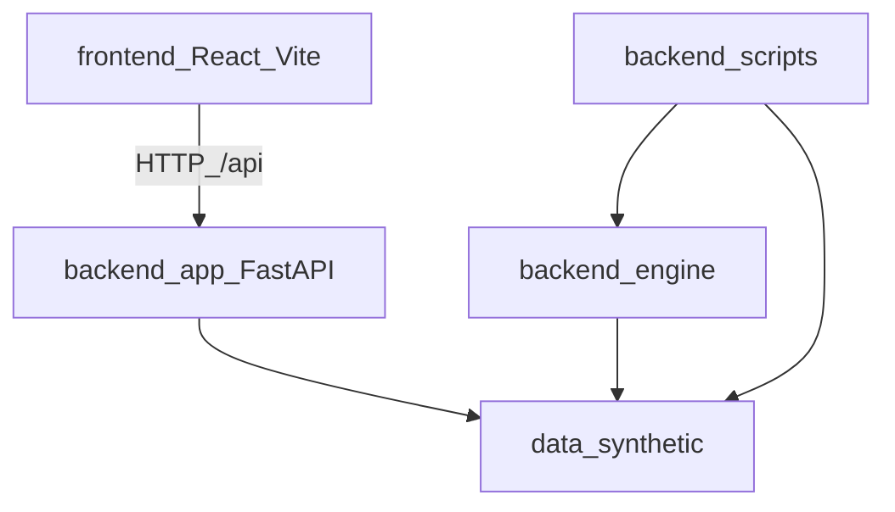

# Engineering Architecture (Codebase)

Companion to [v0.3-system-architecture.md](./v0.3-system-architecture.md). This file maps product layers to repository packages.

| Product layer | Code location |
| --- | --- |
| Consent & data ingestion (prototype) | `backend/scripts/generate_synthetic_cohort.py`, `data/synthetic/` |
| Glass-box risk & uncertainty | `backend/engine/` (`rules`, `model`, `shap_explain`, `uncertainty`, `pipeline`) |
| Pathway router | `backend/engine/router.py` |
| Engagement & choice UI | `frontend/src/pages/CitizenSimulator.tsx` |
| Fairness / privacy / outcomes | `backend/app/services/fairness.py`, `frontend/src/pages/FairnessDashboard.tsx` |
| Clinician card | `frontend/src/pages/ClinicianPortal.tsx` |

## Run order

1. `generate_synthetic_cohort.py`
2. `run_engine.py`
3. `run_evaluation.py`
4. API + UI
