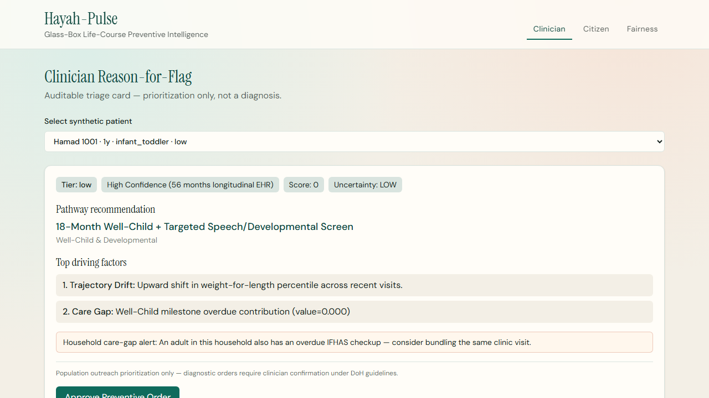
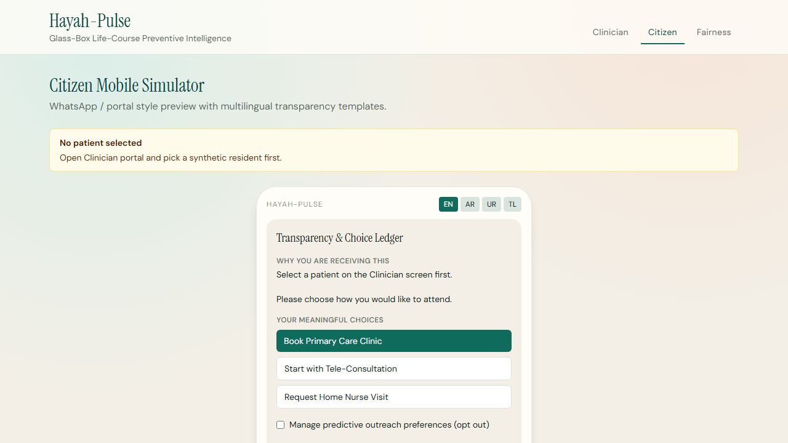
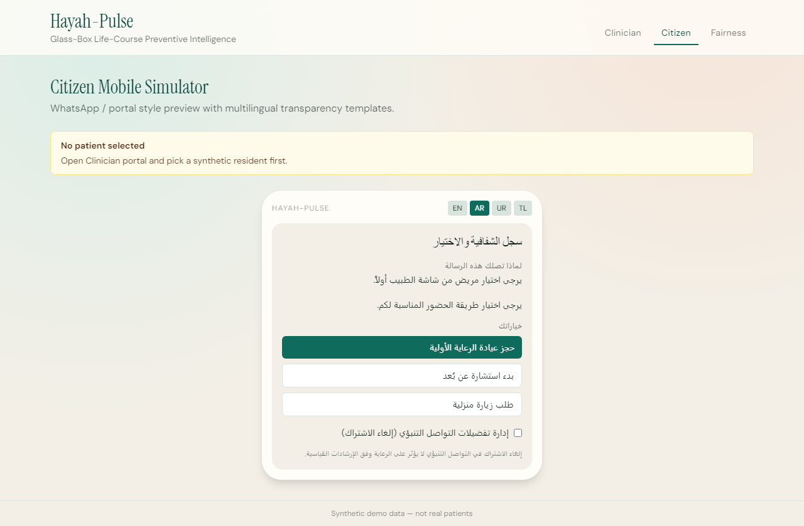
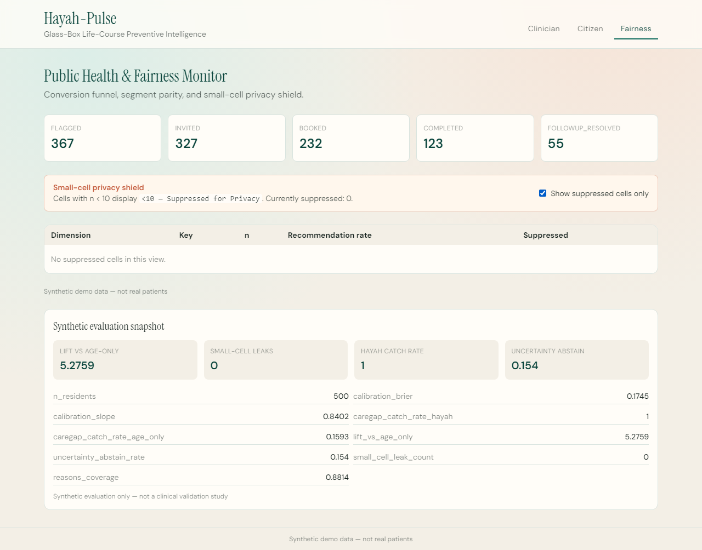

# Hayah-Pulse — pitch slide outline (prototype)

Use with screenshots in this folder. Not a clinical product claim.

## Slide 1 — Problem

Age/sex calendars miss compounding risk across family history, genomics, trajectories, and care gaps.

## Slide 2 — Solution

**Hayah-Pulse**: glass-box, consent-first life-course preventive intelligence for Well-Child + IFHAS.

## Slide 3 — Citizen trust

Transparency & Choice Ledger (EN/AR; UR/TL stubs) — why invited, data used, modality choice, opt-out.

## Slide 4 — Fairness & privacy

Funnel + parity + small-cell suppression (`n < 10`).

## Slide 5 — Evidence (synthetic)

- Positive lift vs age-only rules on synthetic overdue set
- Zero small-cell leaks in aggregate views
- 100% synthetic data — Prototype form selection is legitimate

## Talking points (90s)

See [WALKTHROUGH.md](./WALKTHROUGH.md).
