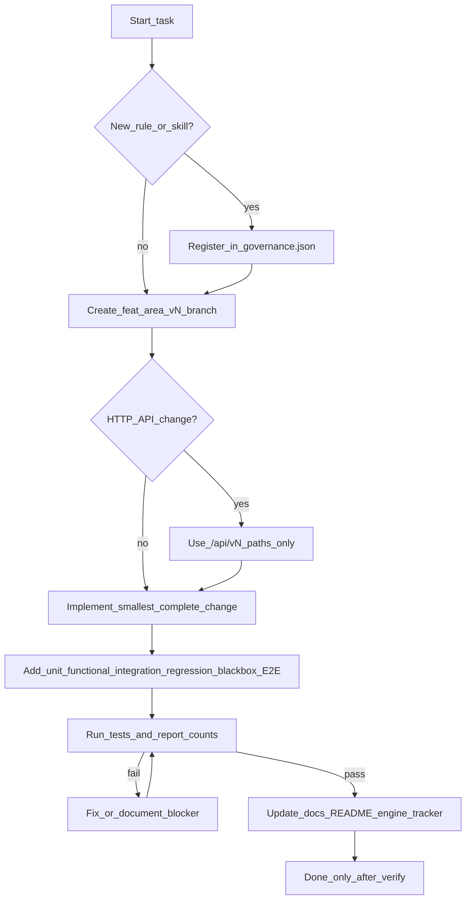

# Governance & Rules Compliance Audit

**Date:** 2026-11-18  
**Scope:** Work done so far (docs + scaffold + prototype engines/UI) vs `.cursor/governance.json` and always-on rules.  
**Verdict (initial):** Governance **registry is OK**. Product implementation **did not follow** versioned branches, API versioning, or full testing layers.

**Remediation in progress on branch `feat/ci-workflow-v1`:** `/api/v1` routes, layered tests, and CI DAG (Unit→…→E2E).

---

## 1. Governance registry check

File: [`.cursor/governance.json`](../.cursor/governance.json)

| Check | Result |
| --- | --- |
| All `.cursor/rules/*.mdc` files registered? | **PASS** — 4 rules listed |
| Registered paths exist on disk? | **PASS** |
| `always_apply` rules match `alwaysApply: true` in `.mdc`? | **PASS** |
| Skills used by project registered? | **PASS** — `skill.ponytail`, `skill.ui-ux-pro-max` |
| Unregistered agent-facing rules/hooks? | **PASS** — none found outside registry |
| `updated_at` current? | **PASS** (2026-11-18) |

### Registered capabilities

| ID | Kind | Status |
| --- | --- | --- |
| `rule.testing-required` | rule | active |
| `rule.versioned-branches` | rule | active |
| `rule.api-versioning` | rule | active |
| `rule.agent-governance` | rule | active |
| `skill.ponytail` | skill | active |
| `skill.ui-ux-pro-max` | skill | active |
| `cursor-ide-agent` | agent | active |

**Governance rule itself:** followed for registry maintenance. No orphan `.mdc` files.

---

## 2. Rule-by-rule compliance (implementation)

### 2.1 `rule.versioned-branches` — **FAIL**

| Required | Actual |
| --- | --- |
| Work on `feat/<area>-vN` (e.g. `feat/prototype-v1`) | Worked on **`main`** |
| Say branch name when creating/switching | Not done |
| Align branch version with API/docs version | Not done |

**Evidence:** `git branch` → `* main`

---

### 2.2 `rule.api-versioning` — **FAIL**

| Required | Actual |
| --- | --- |
| Paths under `/api/v{N}/...` | Unversioned `/api/...` |
| Documented contract = versioned | README documents unversioned paths |

**Current (non-compliant):**

- `GET /api/health`
- `GET /api/residents`
- `GET /api/residents/{id}`
- `GET /api/engine/outputs`
- `GET /api/metrics/evaluation`
- `GET /api/metrics/fairness`

**Required shape:**

- `GET /api/v1/health`
- `GET /api/v1/residents`
- `GET /api/v1/residents/{id}`
- `GET /api/v1/engine/outputs`
- `GET /api/v1/metrics/evaluation`
- `GET /api/v1/metrics/fairness`

Frontend `src/lib/api.ts` calls the unversioned paths → must move with the API.

---

### 2.3 `rule.testing-required` — **PARTIAL FAIL**

| Layer | Required | Present? |
| --- | --- | --- |
| Unit | Yes | **Partial** — `test_rules.py`, `test_uncertainty.py` (flat `backend/tests/`, not `tests/unit/`) |
| Functional | Yes | **Missing** |
| Integration | Yes | **Partial** — `test_health.py` via TestClient only |
| Regression | Yes | **Missing** |
| Black-box | Yes | **Missing** |
| E2E | Yes | **Missing** |
| Self-verify report on each change | Yes | **Inconsistent** (ran once for scaffold; not every follow-up) |

Ran previously: **5 passed** (unit/health only). That does **not** satisfy all layers.

---

### 2.4 `rule.agent-governance` — **PASS**

Registry matches on-disk rules/skills. No unregistered always-on rules.

---

### 2.5 Skills (advisory)

| Skill | Used as intended? |
| --- | --- |
| `skill.ponytail` | Partially — scaffold stayed lean; some breadth exceeded “smallest change” |
| `skill.ui-ux-pro-max` | Not formally invoked for the three screens |

---

## 3. Required flow (follow this from now on)

### Step checklist (copy per task)

1. [ ] Confirm registry if adding agent-facing capability  
2. [ ] `git switch -c feat/<area>-v1` (or next `vN`) — **not on `main` for feature work**  
3. [ ] Public HTTP only under `/api/v1/...`  
4. [ ] Tests in each applicable layer under `backend/tests/{unit,functional,integration,regression,blackbox}/` and `frontend` / `e2e` as needed  
5. [ ] Run tests; report pass/fail  
6. [ ] Update docs touched by the change  
7. [ ] Commit only when user asks  

---

## 4. Remediation backlog (to become compliant)

| Priority | Action | Rule |
| --- | --- | --- |
| P0 | Create `feat/prototype-v1` from current work (stop coding on `main`) | versioned-branches |
| P0 | Move all routes to `/api/v1/...`; update frontend `api.ts`, README, docs | api-versioning |
| P0 | Restructure tests into required layers; add functional, black-box, regression, E2E smoke | testing-required |
| P1 | Wire test commands clearly in README / Makefile | testing-required |
| P1 | Invoke ui-ux-pro-max on next UI polish pass | skill.ui-ux-pro-max |

---

## 5. Summary scorecard

| Rule / governance | Followed? |
| --- | --- |
| Agent governance registry | **Yes** |
| Versioned branches | **Remediated on `feat/ci-workflow-v1`** (was No on `main`) |
| API versioning `/api/v1` | **Remediated on `feat/ci-workflow-v1`** |
| Full testing layers | **Remediated** — unit/integration/functional/regression/blackbox/e2e + CI DAG |
| Overall | **Compliant on `feat/ci-workflow-v1`** (pending merge) |

---

## 6. Change log

| Date | Note |
| --- | --- |
| 2026-11-18 | Initial audit after prototype scaffold |
| 2026-11-18 | `governance.json` updated: active branch, `/api/v1`, CI + test-layer capabilities registered |
