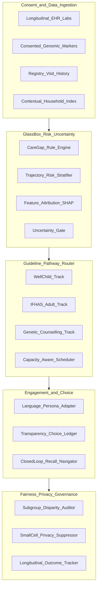

# v0.3 — System Architecture

**Status:** Ready  
**Implements code?** Spec only (guides v0.5–v0.9)  
**Previous:** [v0.2-solution-concept.md](./v0.2-solution-concept.md)  
**Next:** [v0.4-outputs-and-ux.md](./v0.4-outputs-and-ux.md)

---

## 1. Design goal

Five **decoupled layers** so the system can run safely on synthetic data in a prototype today and connect to live Health Information Exchange (HIE) APIs tomorrow.

---

## 2. End-to-end architecture

```
[1. Consent & Data Ingestion Layer]
   ├── Longitudinal EHR & Labs (Malaffi-compatible FHIR/HL7 schema)
   ├── Consented Genomic & Pharmacogenomic Markers (Actionable tiers only)
   ├── Registry & Visit History (Well-Child milestones, IFHAS completion, recalls)
   └── Contextual & Household Index (Geographic exposure, optional family link)
          │
          ▼
[2. Glass-Box Risk & Uncertainty Engine]
   ├── Care-Gap Rule Engine (Detects missed/overdue screenings & vaccines)
   ├── Trajectory & Risk Stratifier (Gradient-boosted / calibrated survival model)
   ├── Feature Attribution Module (SHAP / rule-hybrid top 3–5 clinical drivers)
   └── Data-Completeness & Uncertainty Gate (Abstains when records are sparse)
          │
          ▼
[3. Guideline-Constrained Pathway Router]
   ├── Well-Child & Developmental Track (0–18 yrs: growth, speech, metabolic)
   ├── IFHAS Adult Comprehensive Track (18+ yrs: cardiometabolic, oncology, reproductive)
   ├── Targeted Genetic / Specialist Counselling Track (Actionable variants)
   └── Capacity-Aware Scheduler (Balances invitations against clinic slot supply)
          │
          ▼
[4. Culturally Adapted Engagement & Choice Layer (AI Agent)]
   ├── Language & Persona Adapter (Arabic, English, Urdu, Tagalog; parent/elder framing)
   ├── Transparency & Choice Ledger ("Why You" + "Data Used" + opt-in/out controls)
   └── Closed-Loop Recall Navigator (Automated reminders & rescheduling until attended)
          │
          ▼
[5. Fairness, Privacy & Outcome Governance Layer]
   ├── Subgroup Disparity Auditor (Tracks TPR, FPR, and uptake across demographics)
   ├── Small-Cell Privacy Suppressor (Enforces k-anonymity; masks cells where n < 10)
   └── Longitudinal Outcome Tracker (Bookings → Completed visits → Early detection yield)
```

### Mermaid view



---

## 3. Layer responsibilities

### Layer 1 — Consent & Data Ingestion

- Ingest only authorized sources under explicit consent flags.
- Normalize to a Malaffi-compatible longitudinal schema (prototype: synthetic CSV/JSON).
- Link optional household/family context without exposing unauthorized records.
- Prototype stand-in: [v0.5-synthetic-cohort-and-data-model.md](./v0.5-synthetic-cohort-and-data-model.md).

### Layer 2 — Glass-Box Risk & Uncertainty Engine

- Detect care gaps with deterministic rules.
- Score elevated risk with a calibrated classifier.
- Attribute top 3–5 drivers (SHAP + rule hybrid).
- Abstain / downshift when data completeness is insufficient.
- Spec: [v0.6-risk-engine-spec.md](./v0.6-risk-engine-spec.md).

### Layer 3 — Guideline-Constrained Pathway Router

- Map flags to approved tracks only (Well-Child, IFHAS, Genetic counselling).
- Never invent diagnostic orders; recommendations stay within guideline envelopes.
- Capacity-aware scheduling may be stubbed in prototype (slot supply constant).

### Layer 4 — Culturally Adapted Engagement & Choice

- Generate bilingual (AR/EN minimum) Transparency & Choice messages.
- Offer care modality choices and meaningful opt-out of predictive outreach.
- Prototype: LLM-guardrailed message simulator + static templates.

### Layer 5 — Fairness, Privacy & Outcome Governance

- Track funnel: Flagged → Invited → Booked → Completed → Follow-up resolved.
- Audit TPR/FPR/uptake by segment.
- Suppress any cell with `n < 10` as `<10 — Suppressed for Privacy`.

---

## 4. Prototype vs production boundary

| Concern | Prototype (now) | Production (later) |
| --- | --- | --- |
| Data source | Synthetic cohort (500 / 150 HH) | Malaffi HIE APIs + registries |
| Identity | Synthetic IDs only | Real identifiers under DoH controls |
| Genomics | Synthetic actionable tiers | Consented Newborn / family genomic feeds |
| Scheduling | Stub / simulated slots | Live clinic capacity |
| Messaging | Simulated WhatsApp/portal preview | Approved channels with audit logs |

---

## 5. Clinical firewall (system-wide)

All clinician-facing outputs must carry:

> Population outreach prioritization only — diagnostic orders require clinician confirmation under DoH guidelines.
