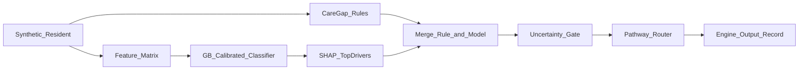

# v0.6 — Risk, Uncertainty & Routing Engine Spec

**Status:** Ready  
**Build step:** **2 of 5**  
**Implements code?** Yes — hybrid rule + ML engine  
**Previous:** [v0.5-synthetic-cohort-and-data-model.md](./v0.5-synthetic-cohort-and-data-model.md)  
**Next:** [v0.7-prototype-screens-spec.md](./v0.7-prototype-screens-spec.md)

---

## 1. Goal

Build a **hybrid** engine that:

1. Flags overdue care with deterministic rules.
2. Scores elevated preventive need with a calibrated classifier.
3. Explains each flag with top 3–5 drivers (SHAP + rules).
4. Applies an **uncertainty gate** that abstains from high-risk clinical alerts when data is sparse.
5. Routes to an approved pathway track.

**Packages:** `pandas`, `numpy`, `scikit-learn`, `shap`

---

## 2. Pipeline overview



---

## 3. Care-gap rule layer

### Well-Child (age &lt; 18)

| Rule ID | Condition | Action |
| --- | --- | --- |
| `WC_OVERDUE_30` | `milestone_overdue_days > 30` | Flag care gap; include in top reasons |
| `WC_DUE_SOON` | `0 < milestone_overdue_days ≤ 30` | Soft reminder priority (optional) |

### IFHAS / adult (age ≥ 18)

| Rule ID | Condition | Action |
| --- | --- | --- |
| `IFHAS_OVERDUE` | `ifhas_overdue_days > 0` | Flag adult screening care gap |
| `IFHAS_OVERDUE_30` | `ifhas_overdue_days > 30` | Elevate priority |

### Compounding context rules (feed reasons, not sole diagnosis)

| Rule ID | Condition | Reason label |
| --- | --- | --- |
| `FHX_PRESENT` | `family_history_flag == true` | Family / genomic context |
| `GENOMIC_ACTIONABLE` | `consented_genomic_tier == actionable` | Actionable metabolic/genetic marker |
| `HBA1C_UP` | `hba1c_trend` above threshold (e.g. &gt; 0.05) | Trajectory drift (glycaemic) |
| `BP_UP` | `bp_trend` above threshold | Trajectory drift (BP) |
| `PED_GROWTH_DRIFT` | pediatric `weight_for_length_percentile_delta` above threshold | Trajectory drift (growth) |

Rule reasons always appear in the Reason-for-Flag list when fired, merged with SHAP drivers (dedupe by theme).

---

## 4. Risk scoring & attribution layer

### Target label (synthetic training)

Create a synthetic binary label `elevated_preventive_need` using a known generative rule (so calibration is meaningful), for example a weighted combination of:

- care-gap overdue flags
- family history
- adverse trends
- actionable genomic tier
- longer EHR history interactions

Add label noise (~5–10%) to avoid trivial perfect separation.

### Model

- Base: `GradientBoostingClassifier` (lightweight)
- Wrap: `CalibratedClassifierCV` (isotonic or sigmoid; prefer isotonic if sample allows)
- Train/test split with fixed seed; report metrics in v0.8

### Features (minimum)

`age`, `sex` (encoded), `ehr_months_history`, `days_since_last_preventive`, `hba1c_trend`, `bp_trend`, `weight_for_length_percentile_delta` (imputed 0 for adults), `family_history_flag`, `consented_genomic_tier` (encoded), `milestone_overdue_days`, `ifhas_overdue_days`, `geographic_exposure_index` (join from household)

### Attribution

- Use `shap` (TreeExplainer or appropriate explainer) to extract **top 3** feature contributions per individual.
- Map feature names to clinician-readable reason strings.
- Final reason list = merge(rule reasons, SHAP top reasons) → unique themes → **top 3–5**.

---

## 5. Uncertainty gate

**Rule (exact):**

IF `ehr_months_history < 6` AND `consented_genomic_tier` in `{None, null, none}`  
THEN:

- `uncertainty = HIGH`
- `confidence_badge = Low Confidence / Sparse Record (Trigger Baseline Intake)`
- **Do not** emit a high-risk clinical alert
- Route to **`Baseline Wellness Onboarding`**

ELSE:

- `uncertainty = LOW` when `ehr_months_history >= 24` and genomic or rich visit history present → High Confidence badge copy
- Otherwise `uncertainty = MEDIUM`

Uncertainty overrides model risk tier for messaging: sparse → onboarding path.

---

## 6. Pathway router

| Track | Eligibility | Example recommendation string |
| --- | --- | --- |
| **Well-Child & Developmental** | age &lt; 18 | `18-Month Well-Child + Targeted Speech/Developmental Screen` |
| **IFHAS Adult Comprehensive** | age ≥ 18 | `Priority IFHAS Cardiometabolic + Early HbA1c Panel` |
| **Targeted Genetic / Specialist Counselling** | `consented_genomic_tier == actionable` AND not uncertainty-HIGH | `Targeted Genetic Counselling + Pathway-Aligned Screen` |
| **Baseline Wellness Onboarding** | uncertainty HIGH | `Baseline Wellness Onboarding (Sparse Record)` |

Router selects primary track; may attach secondary household bundle hint for citizen ledger (adult IFHAS due + child Well-Child due).

### Capacity-aware scheduler (prototype stub)

- Constant clinic capacity parameter; optionally down-rank lowest priority invitations if over daily cap.
- Full live scheduling is out of prototype scope.

---

## 7. Engine output record (per resident)

| Field | Type | Notes |
| --- | --- | --- |
| `resident_id` | string | |
| `risk_score` | float 0–1 | Calibrated probability |
| `risk_tier` | enum | `high` / `medium` / `low` / `baseline_onboarding` |
| `uncertainty` | enum | `HIGH` / `MEDIUM` / `LOW` |
| `confidence_badge` | string | Display copy |
| `top_reasons` | list[object] | `{rank, theme, detail}` |
| `rule_hits` | list[string] | Rule IDs |
| `pathway` | string | Router track |
| `pathway_recommendation` | string | Clinician-facing sentence |
| `clinical_firewall` | string | Fixed disclaimer |
| `data_sources_used` | list[string] | For citizen ledger |
| `data_sources_not_used` | list[string] | Explicit exclusions |
| `household_bundle_hint` | string/null | Optional |

Persist to:

```
data/synthetic/engine_outputs.json
data/synthetic/engine_outputs.csv
```

---

## 8. Acceptance criteria (Step 2 done when)

- [ ] Care-gap rules fire correctly on overdue synthetic rows
- [ ] Calibrated GB model trains on synthetic labels and writes scores for all 500 residents
- [ ] Each non-suppressed flag has 3–5 readable reasons
- [ ] Uncertainty gate routes sparse records to Baseline Wellness Onboarding
- [ ] Pathway recommendations stay within the four tracks above
- [ ] Clinical firewall string present on every clinician-bound record
- [ ] Outputs saved under `data/synthetic/`
